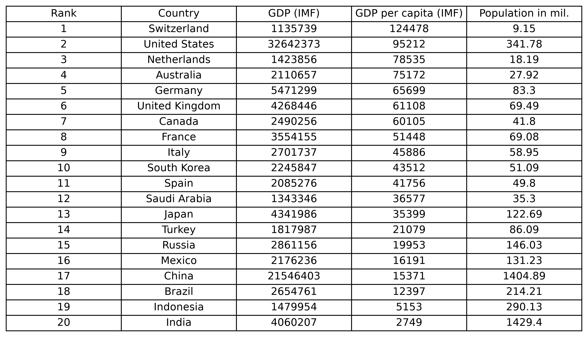
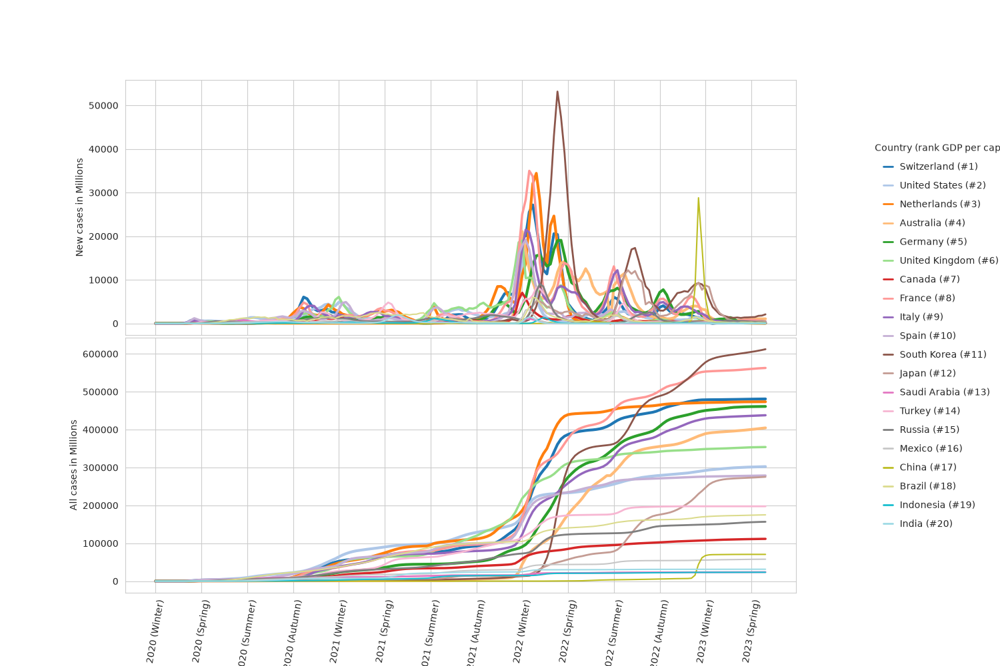
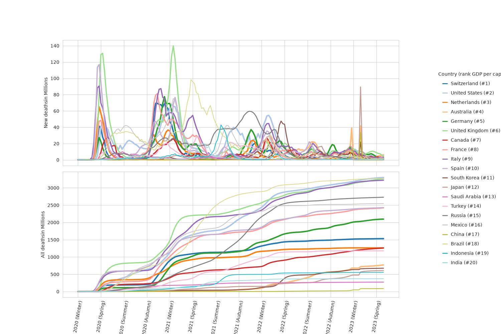

# Analyzing the effects of the pandemic in the top 20 GDP countries (up to Nov. 2026)

*This project is still under development*

## Goal
During and after the COVID-19 pandemic, we often heard vastly different and sometimes contradictory views about its long-term impacts in areas such as education, the economy, and, of course, national health. I was curious to know that in 2026, after almost 4 years, when [WHO declared the end of the pandemic](https://doi.org/10.1016/j.jiph.2025.102698) on 5th of May 2023, what effects are still prevalent. I was particularly interested in understanding:

1. The country's response to the pandemic, e.g., the evolution of the number of new cases and deaths
2. Effects on the national education systems, e.g., the number of children who exhibit educational difficulties
3. Effects on the economy, e.g., GDP trends before and after the pandemic
4. National health, e.g., life expectancy and population growth

To constrain my explorations and analysis, only the data (when available) regarding the top 20 countries in GDP ranking (Wikipedia) are obtained and stored. Meanwhile, since the population size can vastly affect the GDP, I reorder/rank the list according to the GDP per capita in a descending fashion (depicted in the figure below).

- GDP is reported in millions of USD, and GDP per capita in USD (2025 value)
- Data source: Wikipedia (obtained from World Bank)
## Results
Note: Russia-Ukraine and Iran-US wars.
### A country's response to the pandemic

1. **Jumps in the new cases for 2021/2022 and 2022/2023 seasons**: Based on scientific articles (e.g. doi:[10.3390/jcm12134517](https://doi.org/10.3390/jcm12134517)), the spikes in the number of new cases in the 2nd and 3rd years of the pandemic have had different causes. In particular, it has been claimed that numbers in the autumn of 21 and winter of 22, are positively correlated with the arrival of COVID variants, such as Alpha, Beta, Delta, Kappa, Eta, as well as Omicron sublineages (BA.1, BA.2). Meanwhile, it is argued that, in the autumn of 22 and winter of 23, waning vaccine boosters, lifting of national COVID restrictions, and return of other respiratory diseases such as influenza were more of causal factors. Regarding the national lockdowns, especially in the first two years of COVID, I would also note that the trends in the number of all cases support their effectiveness in controlling the spread of the disease. However, the minimal presence of COVID in 2026, more than 3 years after the pandemic, is in contradiction to this assessment.

2. South Korea and France have had the highest overall number of cases relative to their population, while, with a small gap, Switzerland, the Netherlands, and  Germany trail behind them. Meanwhile, among the 7 countries with the lowest reported cases- Turkey, Brazil, Russia, Canada, China, Mexico, Indonesia, and India- it is only Canada that did not face international scrutiny. Examples can be found in these reports: [Healthpolicy](https://healthpolicy-watch.news/74819-2/) and [Guardian](https://www.theguardian.com/world/2023/jan/05/china-data-under-represents-true-impact-of-covid-outbreak-who) for China, [Radio Free Europe/Radio Liberty (RFE/RL)](https://www.rferl.org/a/russia-covid-deaths-double-numbers/31536128.html) and [VOA](https://www.voanews.com/a/russian-agency-more-than-49-000-died-from-covid-19-in-august-/6263897.html) for Russia, [Leaked Health Ministry documents in Duvar English](https://www.duvarenglish.com/coronavirus/2020/09/30/turkish-health-ministry-has-only-been-publishing-symptomatic-coronavirus-cases-says-minister) for Turkey. In Canada's case, despite not being accused of governmental manipulation, the country was plagued by a lack of harmonized provincial reporting systems and testing bottlenecks.

1. **In contrast to the number of cases**, the mortality is higher in the first two years of the pandemic. This is also supported by the fact that the variants of the COVID-19 virus evolved to prioritize rapid transmission of the disease instead of its potency. Meanwhile, based on the weekly death numbers, only cases such as Switzerland, the Netherlands, Russian, Indonesia, India, and Saudi Arabia seem **to have controlled the fatality rate by the Spring of 2022**. However, it is difficult to trust these reports except maybe for Switzerland and the Netherlands, because of a lack of governmental transparency. 
   
2. The UK shows the highest death tolls in both of the death waves in 2020 and 2021. Apart from the UK, Brazil, US, and Italy have had the highest number of overall deaths recorded after more than 3 years of the pandemic. This is particularly interesting in the case of Brazil who had shown relatively lower number of reported cases despite of its population size. Another interesting fact one can note is the steadily high number of deaths in Russia's COVID cases until the winter of 2022, which was the start of the Russia-Ukraine war. Given Russia's history of a lack of governmental transparency regarding different societal issues, this sudden drop in reported deaths is probably not that surprising. 
### Economy
### Education
### Health trends

## Data sources

1. Wikipedia: [GDP (2026)](https://en.wikipedia.org/wiki/List_of_countries_by_GDP_(nominal)), [GDP per capita (2026)](https://en.wikipedia.org/wiki/List_of_countries_and_dependencies_by_population), [Populations (2026)](https://en.wikipedia.org/wiki/List_of_countries_and_dependencies_by_population)
  
2. [Worldindata's COVID-19 data](https://ourworldindata.org/covid-deaths): Number of new cases/deaths, Number of administered vaccines, Number of tests

3. [WorldBank](https://data.worldbank.org/)

    1. Economy:
       - GDP
       - Education expenditure
       - Health expenditure
       - Export value index
       - Exports of goods and services (% of GDP)
       - Labor force

    2. Education:
       - Educational attainment
       - Number of students at various levels
       - Share of youth not in education, employment, or training
       - Unemployment with different levels of education (% of labor force)

    4. Health:
       - Death rate
       - Population
       - Life expectancy at birth
       - Obesity (BMI-based)
       - Suicide rate
       - Alcohol consumption
         
4. [Eurostat](https://ec.europa.eu/eurostat/web/main/data/database): Energy commodities (Gas and Electricity) prices in EU countries

## Data model
A graph of the data model can be seen in [this figure](Figures/database_model.png)
## Summary of the Analysis
### A country's response to the pandemic
**Questions**:
1. Evolution of new cases and deaths weekly from Jan. 2020 to May 2023
2. Covid variants, infection waves, which country had it worst
3. How fast did countries administer new tests and does it correlate with the registered new cases
4. Can we identify any noticeable effect on the new cases/deaths based on the number of administered vaccinces
5. 

### Economy

### Education

### Health trends

## Packages
Pandas, Requests (for scraping and interacting with REST API), NumPy, Matplotlib, Sqlalchemy.

## Notebooks
*Creating the DB:* [Jupyter notebook](./creating_db.ipynb)

First, using a simple script (requests, pandas), I scraped the list of top 20 countries in GDP rankings (oredered based on their GDP-per-capita), along with their respective populations. Then, I trim down the Covid data to include only these countries. Finally, using Sqlalchemy, I populated the tables in the DB with the data.

*Analysis:* [Jupyter notebook](./Analysis.ipynb)

All the analysis is done up to 5th of May 2023, when WHO declared the end of world wide pandemic.

